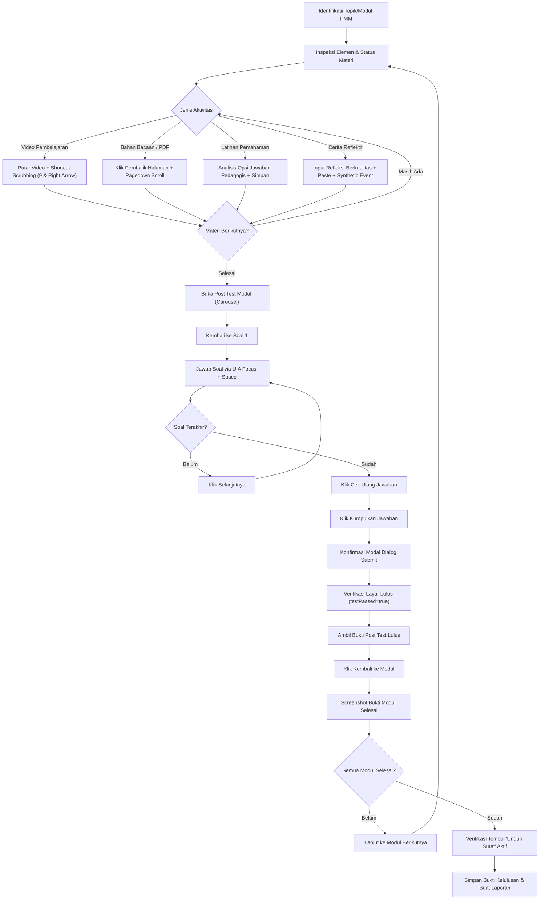

# Agent Pelatihan: Otomatisasi Pelatihan Mandiri PMM

Skill ini menyediakan panduan operasional dan kumpulan pustaka otomasi lengkap untuk menyelesaikan modul dan topik pada **Platform Merdeka Mengajar (PMM - guru.kemendikdasmen.go.id)** secara otomatis, akurat, dan tuntas menggunakan headed browser interaction dan Accessibility Tree (UIA).

---

## 1. Arsitektur & Prinsip Kerja

Otomatisasi bekerja pada browser Google Chrome yang terhubung dengan utilitas desktop automation (`agent-desktop-win32-x64.exe`). Alur otomasi memadukan:
1. **Accessibility Tree Inspection (UIA):** Membaca struktur DOM, tautan modul, status pengerjaan, tombol aksi, butir soal, dan pilihan ganda secara deterministik tanpa terpengaruh posisi scroll.
2. **Headed Synthetic Input Delivery:** Mengirimkan ketukan tombol keyboard dan koordinat klik mouse fisik untuk berinteraksi dengan elemen web yang sensitif (seperti iframe YouTube, penampil PDF berhalaman, dan textarea refleksi).
3. **Deterministic Option Selection (Focus + Space):** Menghindari bias koordinat atau text wrapping drift pada pilihan ganda dengan menavigasikan fokus langsung ke node `radiobutton` dan mengirimkan penekanan `space`.
4. **Domain-Specific Pedagogical Knowledge:** Memilih jawaban kuis dan post test berdasarkan prinsip pendidikan Kurikulum Merdeka, pemikiran Ki Hadjar Dewantara, Taksonomi SOLO/Bloom, serta asesmen autentik.

---

## 2. Alur Kerja Otomatisasi (Workflow)

---

## 3. Prosedur Teknis per Komponen

### A. Navigasi Aman (Mencegah Focus Trap pada Omnibox)
- Saat menavigasikan Chrome melalui URL address bar (`ctrl+l` -> `ctrl+v` -> `return`), kursor sering tertinggal di address bar sehingga Accessibility Tree halaman web tidak terbaca secara normal.
- **Solusi Standar:**
  1. Fokuskan jendela Chrome: `focus-window --window-id <ID>`.
  2. Buka URL: tekan `ctrl+l`, tempel URL dari clipboard, tekan `return`.
  3. Beri jeda 2-3 detik hingga halaman termuat.
  4. Tekan `escape` dan lakukan klik fisik pada area netral halaman (misal: koordinat tengah layar browser `--xy=-540,500`) untuk mengembalikan fokus ke dokumen web.

### B. Otomatisasi Video Pembelajaran (YouTube Embed)
- Video pada platform PMM menggunakan YouTube player tersemat. Progress video akan tercatat tuntas (`recordProgress=false`) apabila video diputar hingga titik akhir durasi.
- **Prosedur Eksekusi:**
  1. Buka URL video dengan parameter `recordProgress=true`.
  2. Klik fisik di tengah video player (misal koordinat `--xy=-654,401`) untuk memulai pemutaran.
  3. Tunggu 2 detik, lalu kirimkan penekanan tombol `9` (melompati pemutaran ke menit/detik ke-90%).
  4. Kirimkan penekanan tombol `right` arrow sebanyak 15 kali dengan jeda 0.15 detik untuk menggeser timeline video ke detik-detik terakhir.
  5. Beri jeda tunggu minimal 4 detik agar event playback selesai dan status tersimpan di backend PMM.

### C. Otomatisasi Bahan Bacaan & Dokumen PDF
- Bahan bacaan PDF di PMM mensyaratkan pengguna membuka setiap lembar dokumen agar progres terhitung tuntas.
- **Prosedur Eksekusi:**
  1. Buka URL teks bahan bacaan.
  2. Lakukan klik fisik berulang pada tombol navigasi halaman berikutnya di toolbar viewer (misal koordinat layar `--xy=-239,1811`) sebanyak jumlah halaman (biasanya 2 hingga 5 kali klik dengan jeda 0.8 detik).
  3. Kirimkan penekanan `pagedown` sebanyak 5 kali untuk memastikan scroll area tercapai.
  4. Beri jeda 2 detik sebelum melanjutkan ke item berikutnya.

### D. Pengerjaan Latihan Pemahaman (Kuis Materi)
- Setiap akhir materi terdapat 1 sampai 6 soal kuis latihan pemahaman pilihan ganda.
- **Prosedur Eksekusi:**
  1. Ambil snapshot UIA pada container `Chrome Legacy Window`.
  2. Temukan seluruh node `radiobutton` beserta nama teks dan `ref_id`-nya.
  3. Nilai setiap opsi menggunakan fungsi skoring pedagogis:
     - Berikan bobot positif tinggi (+5) untuk kata kunci Kurikulum Merdeka (*refleksi, peserta didik, kebutuhan murid, kolaboratif, kontekstual, bermakna, mendalam, umpan balik, evaluasi*).
     - Berikan penalti (-10) untuk kata kunci otoriter/pasif (*menghukum, menegur, mengabaikan, menyalahkan, hafalan, ceramah tradisional*).
  4. Pilih radio button dengan skor tertinggi (`focus` -> `space`).
  5. Klik tombol `Jawab`, lalu klik `Lanjut`.
  6. Pada akhir kuis, klik tombol `Kembali ke Materi`.

### E. Pengisian Cerita Reflektif
- Setiap materi memiliki form refleksi dengan textarea kosong (minimal 50 karakter).
- **Prosedur Eksekusi:**
  1. Fokuskan textarea refleksi melalui klik fisik (misal koordinat `--xy=-540,500`).
  2. Siapkan teks refleksi pedagogis yang mendalam.
  3. Bersihkan tanda petik tunggal (`'`) dari string teks untuk menghindari syntax error pada PowerShell saat dimasukkan ke clipboard.
  4. Set clipboard melalui PowerShell: `powershell -NoProfile -Command "Set-Clipboard -Value '<clean_text>'"`.
  5. Kirimkan `ctrl+a` -> `backspace` -> `ctrl+v`.
  6. Kirimkan penekanan tombol `space` diikuti `backspace` untuk memicu event form change React dan mengaktifkan tombol `Simpan`.
  7. Cari tombol `Simpan` di UIA tree (periksa agar tidak berstatus `disabled`), lalu fokuskan dan tekan `space` (atau fallback klik ke `-540, 1810`).

### F. Pengerjaan Post Test Modul (Carousel & Modal Konfirmasi)
- Post Test di PMM disusun dalam bentuk **MUI Carousel Slider** (1 soal per slide tampilan).
- **Prosedur Eksekusi:**
  1. Buka URL Post Test modul, klik tombol `Mulai Kerjakan Post Test`.
  2. Tekan tombol `Sebelumnya` berulang kali untuk memastikan berada pada Soal 1.
  3. Untuk setiap soal (1 s.d. N):
     - Cari node `radiobutton` aktif yang sesuai dengan kunci jawaban (bisa berupa teks opsi atau indeks huruf A/B/C/D).
     - Fokuskan node dan kirimkan tombol `space` (`focus` -> `space`).
     - Tekan tombol `Selanjutnya` (atau pada soal terakhir, tekan `Cek Ulang Jawaban`).
  4. Pada halaman reviu seluruh jawaban, tekan tombol `Kumpulkan`.
  5. **Modal Konfirmasi:** Tunggu munculnya modal dialog konfirmasi ("Apakah Anda yakin..."), cari tombol `Kumpulkan` di dalam modal, lalu fokuskan dan tekan `space`.
  6. Tunggu navigasi ke halaman hasil evaluasi (`.../post-test/passed?...testPassed=true`) dan simpan tangkapan layar bukti kelulusan (`bukti_posttest_result.png`).
  7. Tekan tombol `Kembali ke Modul` dan ambil screenshot modul selesai (`bukti_selesai_modul.png`).

### G. Verifikasi Kelulusan Topik & Surat Keterangan
- Regulasi terkini PMM: **Aksi Nyata tidak lagi diwajibkan** untuk menyelesaikan topik pelatihan mandiri.
- Begitu seluruh modul dalam topik tuntas, sistem PMM langsung menerbitkan **Surat Keterangan Selesai Topik**.
- **Prosedur Eksekusi:**
  1. Buka halaman utama topik: `https://guru.kemendikdasmen.go.id/pelatihan-mandiri/topik/<TOPIK_ID>`.
  2. Verifikasi bahwa seluruh modul telah berstatus centang hijau (Selesai).
  3. Verifikasi bahwa tombol `Unduh Surat` (link menuju `/surat-selesai-belajar`) telah muncul dan berstatus aktif.
  4. Buka halaman Surat Selesai Belajar dan ambil tangkapan layar penuh sebagai bukti resmi.

---

## 4. Struktur Pustaka Skrip (`scripts/`)

Pustaka skrip modular yang disertakan pada folder `scripts/`:
- `runner.py`: Wrapper pemanggil CLI `agent-desktop-win32-x64.exe`.
- `navigator.py`: Utilitas navigasi URL Chrome dengan pembersihan omnibox focus trap dan deteksi window multi-display.
- `video_runner.py`: Otomasi penuntasan video pembelajaran YouTube embed via keyboard shortcuts.
- `text_runner.py`: Otomasi membaca dan membalik halaman materi bacaan/PDF.
- `quiz_solver.py`: Algoritma penyelesaian otomatis Latihan Pemahaman berbasis skoring pedagogis.
- `refleksi_submitter.py`: Generator dan submitter Cerita Reflektif dengan dispatch event sintetis.
- `posttest_solver.py`: Engine penyelesaian Post Test berbasis Carousel Slider dan penanganan Modal Dialog Konfirmasi.
- `orchestrator.py`: Pipeline otomatisasi end-to-end modul (inspeksi materi -> tuntas materi -> kuis -> refleksi -> post test).
- `verifier.py`: Inspektor status topik, modul, dan pengambil screenshot bukti penyelesaian.

---

## 5. Ringkasan Kunci Jawaban Referensi (Topik Populer)

Tersedia berkas referensi pedagogis lengkap di folder `references/`:
- `pmm_pedagogy_guide.md`: Rangkuman komprehensif teori KHD, Taksonomi SOLO, Asesmen Autentik, dan Model Pembelajaran Mendalam.
- `troubleshooting_guide.md`: Kumpulan solusi error umum (PowerShell parameter error, UIA AMBIGUOUS_TARGET, omnibox trap, offset drift multi-line radio options, modal confirmation dialogs).
